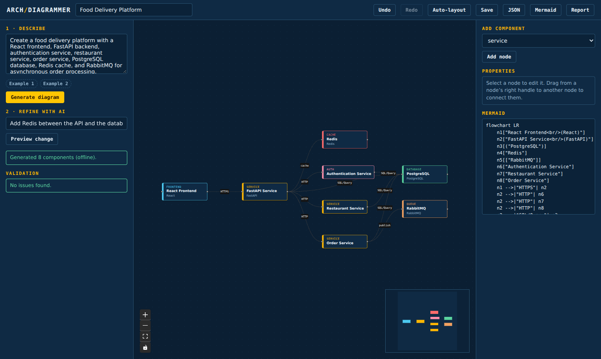

# Interactive Visual Architecture Diagrammer

Describe a system in plain English → get an editable architecture diagram (React Flow), a Mermaid definition, validation, AI-assisted edits with change preview, undo/redo, save and export.



## Quick start
```bash
npm install
cp .env.example .env.local     # optional: add ANTHROPIC_API_KEY
npm run dev                    # http://localhost:3000
```
Without `ANTHROPIC_API_KEY` the app runs in **offline mode** using a built-in keyword generator (recognises React/Vue/Next, FastAPI/Express/Django…, PostgreSQL/MySQL/MongoDB, Redis, RabbitMQ/Kafka/SQS, Stripe/PayPal/Twilio, S3, "X service", gateways, workers). With a key, generation and modification go through the Anthropic API (`ANTHROPIC_MODEL`, default `claude-sonnet-5-5`); all model output is parsed and validated with Zod before it reaches the editor.

## Scripts
| Command | What it does |
|---|---|
| `npm test` | 30 unit + API-route tests (Vitest) |
| `npm run typecheck` | `tsc --noEmit` |
| `npm run build` | production build |
| `npm run e2e` | 12-step browser test (needs `npm run build`); regenerates `docs/screenshots/` |

## Architecture
Canonical JSON graph (`src/lib/schema.ts`) is the single source of truth. React Flow renders/edits it, Mermaid is generated from it (`toMermaid`), the AI only proposes validated *operations* (`addNode`, `removeNode`, `updateNode`, `addEdge`, `removeEdge`) which are previewed as a diff before applying.

```
src/lib/schema.ts      Zod schemas + types        src/lib/graph.ts      validate, applyOps, diff, layout, Mermaid
src/lib/heuristic.ts   offline generator/modifier src/lib/ai.ts         Anthropic client + fallback
src/app/api/*          generate | modify | validate | export
src/components/Editor.tsx   canvas, panels, undo/redo, export, save
```

## Not included (from the original plan)
PostgreSQL/Prisma persistence, auth, server-side version history, SVG/PNG export and a Mermaid *renderer* (Mermaid source is shown/exported as text). Projects save to browser localStorage.
